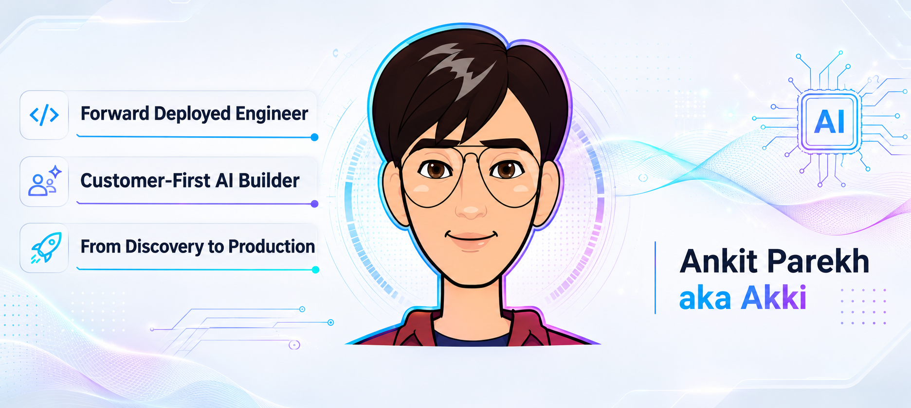

  

# Ankit Parekh

**Principal Forward-Deployed Engineer · Frontend Architect · Enterprise AI Architect**

I work directly with customers to understand complex business problems, design the right technical solution, and take it from discovery to production. My focus is on applied AI, enterprise application architecture, and reliable systems that people can use in their everyday workflows.

**[Live portfolio](https://ankit-parekh.org/)** · **[Resume (PDF)](./AnkitParekh_Resume.pdf)** · **[Resume (Word)](./AnkitParekh_Resume.docx)** · **[Open-source projects](https://ankit-parekh.org/open-source-projects.html)** · **[LinkedIn](https://www.linkedin.com/in/akkiparekh)**

## Forward-Deployed Engineering

I combine customer engagement, hands-on engineering, architecture and production ownership. I aim to understand the problem before choosing the technology, and use AI where it adds demonstrable value.

| From discovery to production | How I work |
| --- | --- |
| Customer discovery | Understand business workflows, constraints and pain points directly with users and stakeholders. |
| Solution architecture | Translate requirements into practical application designs, integration contracts and delivery plans. |
| Hands-on implementation | Build frontend and backend integrations, applied AI workflows, copilots and agentic systems. |
| Evaluation and governance | Define acceptance criteria, evaluate behavior, enforce tool permissions and require approval for consequential actions. |
| Deployment and adoption | Demonstrate solutions, incorporate feedback, troubleshoot customer-specific issues and support reliable releases. |

## Selected professional work

### Bluemeteor — Enterprise AI and customer-facing delivery

Designed and delivered a governed AI multi-agent assistant for enterprise product-content workflows. Worked directly with customers to identify supplier onboarding, product catalog mapping and SKU validation challenges.

| Work | Outcome |
| --- | --- |
| SOP Co-Pilot / AI multi-agent assistant | Delivered a paid production feature adopted by 11 customer organizations, with retrieval-backed answers, multi-step execution, human approvals and audit trails. |
| AI-assisted catalog mapping | Personally designed and implemented AI-assisted mapping of supplier product data to distributor requirements. |
| Missing SKU attributes | Built AI suggestions for incomplete product attributes using distributor-defined validation rules and review workflows. |
| Enterprise frontend performance | Reduced approximately 551 lookup operations to 40 for visible rows, removing a multi-minute UI freeze in an AG Grid Enterprise workflow. |

Customer demonstrations, feedback-driven improvements, customer-specific troubleshooting and evaluation-gated releases were part of the delivery process.

### Forto — Enterprise frontend architecture

Worked on production frontend architecture in Berlin, using React, Next.js and TypeScript. Translated stakeholder requirements into application flows, established typed interfaces and delivered user-facing features through release.

Explore the [portfolio](https://ankit-parekh.org/) for additional career experience, case studies and technical context.

## Core engineering expertise

| Area | Capabilities |
| --- | --- |
| Forward-Deployed Engineering | Customer discovery, solution design, technical integration, stakeholder collaboration, deployment and adoption |
| Applied AI and agentic systems | LLM integrations, RAG, MCP, tool orchestration, model routing, agent lifecycle and contextual copilots |
| Enterprise frontend architecture | Angular, React, Next.js, TypeScript, RxJS, Signals, design systems, accessibility and data-intensive interfaces |
| Full-stack and platform engineering | Node.js, NestJS, API integration, authentication, PostgreSQL, Supabase and application boundaries |
| AI reliability and governance | Evaluation harnesses, release gates, human-in-the-loop approvals, scoped tools, evidence, auditability and failure recovery |
| Engineering delivery | Technical leadership, CI/CD, GitHub Actions, Playwright, Docker and Kubernetes deployment patterns |

## Selected open-source engineering projects

These repositories provide public examples of my engineering approach. They are distinct from the commercial production work described above; individual project documentation defines implementation scope, demo limitations and release status.

### Agentic AI and enterprise platforms

| Project | Engineering focus |
| --- | --- |
| [Org AI Force](https://github.com/AnkitParekh007/org-ai-force) | Enterprise agent workspace with Angular, NestJS, governed tools, orchestration and operator visibility. |
| [ngx-copilot-platform](https://github.com/AnkitParekh007/ngx-copilot-platform) | Embeddable Angular copilot platform, typed SDK contracts, streaming, retrieval evidence and backend-owned approvals. |
| [Agent Studio](https://github.com/AnkitParekh007/agent-studio) | Governed agent application factory, lifecycle and version state, runtime adapters and publishing patterns. |
| [ContextOps AI](https://github.com/AnkitParekh007/contextOps) | Evaluation workspace exploring model cost and measured task quality. |
| [Frontend AI Patterns](https://github.com/AnkitParekh007/frontend-ai-patterns) | Reusable contracts for streaming AI, citations, tools, approvals, recovery and guardrails. |
| [Angular AI Copilot Starter](https://github.com/AnkitParekh007/angular-ai-copilot-starter) | Runnable reference for Ask/Plan/Execute/Debug interactions, retrieval cards and approval timelines. |

### Applied AI products and developer workflows

| Project | Engineering focus |
| --- | --- |
| [ContributorOps](https://github.com/AnkitParekh007/contributorOps) | Contribution discovery, reviewable pull requests and evidence of shipped work. |
| [ReboundOps](https://github.com/AnkitParekh007/rebound-ops) | Privacy-first job-search workspace and fact-grounded application preparation. |
| [Job Search Assistant](https://github.com/AnkitParekh007/job-search-assistant) | macOS interface for AI-assisted discovery, ranking, preparation, approvals and tracking. |
| [devdocs-forge-agent](https://github.com/AnkitParekh007/devdocs-forge-agent) | Provider-agnostic TypeScript documentation agent with local-first workflows and human review. |
| [interviewOps](https://github.com/AnkitParekh007/interviewOps) | Angular and TypeScript application exploring provider abstraction, validation and ethics guardrails. |

### Engineering education and community

| Project | Engineering focus |
| --- | --- |
| [Zero to FDE](https://github.com/AnkitParekh007/forward-deployed-engineering-from-scratch) | Practical Forward-Deployed Engineering curriculum with customer scenarios, field drills and capstone projects. |
| [Agentic Engineering Playbook](https://github.com/AnkitParekh007/Agentic-Engineering-Playbook) | Project-based learning for model gateways, RAG, orchestration, MCP, agentic UI and browser automation. |
| [AI Tools Cheatsheets](https://github.com/AnkitParekh007/ai-tools-cheatsheets) | Engineering handbook for coding agents, MCP, workflows, governance and team adoption. |

[Explore the complete project showcase →](https://ankit-parekh.org/open-source-projects.html)

## Engineering principles

- **Customer problems first:** Start with the workflow and the expected outcome, not a model or framework.
- **Deterministic boundaries, flexible intelligence:** Keep authorization, policy and sensitive execution under application control.
- **Evidence before release:** Evaluate behavior and failure modes, and make important decisions inspectable.
- **Human control by design:** Provide clear approvals, citations, recovery paths and audit trails.
- **Own the outcome:** Consider usability, integrations, deployment, operational reliability and customer feedback together.

## For hiring managers and engineering leaders

Start with the [live portfolio](https://ankit-parekh.org/) and [resume](./AnkitParekh_Resume.pdf) for career history and professional delivery evidence. For a technical review, inspect [ngx-copilot-platform](https://github.com/AnkitParekh007/ngx-copilot-platform), [Org AI Force](https://github.com/AnkitParekh007/org-ai-force) and [Agent Studio](https://github.com/AnkitParekh007/agent-studio), including their architecture documentation, tests and documented limitations.

Relevant role families include Forward-Deployed Engineering, Applied AI Engineering, AI Solutions Engineering and Architecture, Principal/Staff Engineering, enterprise frontend architecture and full-stack AI product engineering.

## About this repository

This repository contains the source for my personal portfolio at [ankit-parekh.org](https://ankit-parekh.org/), including the public resume downloads, project showcase, website assets and supporting code.

| Path | Purpose |
| --- | --- |
| `index.html` | Main portfolio and career overview |
| `open-source-projects.html` | Public engineering project showcase |
| `AnkitParekh_Resume.pdf` / `AnkitParekh_Resume.docx` | Downloadable resume formats |
| `assets/`, `css/`, `js/`, `img/` | Website assets and frontend code |
| `agent-api/` | Supporting agent API code |

This is a personal portfolio repository rather than a general-purpose software library. External changes are not expected.

## Connect

**[Portfolio](https://ankit-parekh.org/)** · **[LinkedIn](https://www.linkedin.com/in/akkiparekh)** · **[GitHub](https://github.com/AnkitParekh007)**

> Understand the customer problem. Build the right solution. Take responsibility for how it works in production.

## Engineering blog

`/blog/` is a static publication generated by the separate blogOps engine. Only reviewed rendered public output belongs in `blog/`; never copy private research history, drafts, model keys or editorial manifests here. The portfolio CI validates blog routes, category archives, canonical URLs, RSS/sitemap consistency, and the public artifact boundary before deploying. Future reviewed content updates should arrive as pull requests limited to `blog/`.
